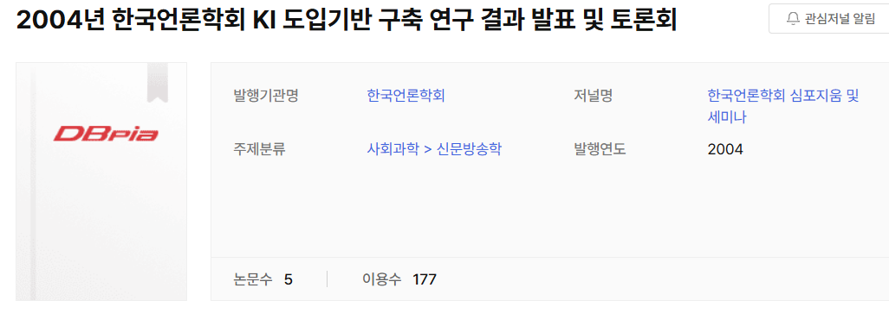

<h1>KI 도입기반 구축 연구: 방송내용평가 개선연구</h1>

<h3>A Study on Establishing the Foundation for KI Implementation: Improving Broadcast Content Evaluation</h3>

<h2>연구자료</h2>

  

  <a href="https://www.dbpia.co.kr/journal/voisDetail?voisId=VOIS00045162">
    📖 DBpia 학술행사 및 연구자료 바로가기
  </a>

